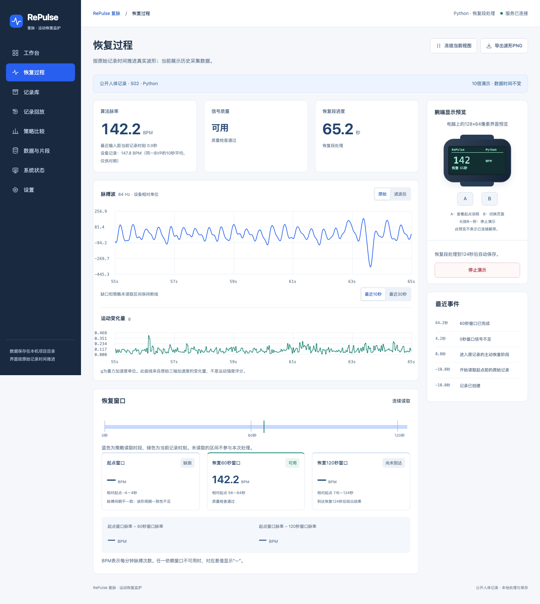

# RePulse 复脉

运动恢复监护课程项目。系统读取下载到本地的公开人体记录，显示脉搏波、运动变化和信号质量，计算恢复起点、60秒和120秒附近的窗口脉率及变化量。

目录和文件用途见 [项目文件与目录说明](docs/PROJECT_STRUCTURE.md)。



## 数据来源

使用 PhysioNet 的 [Wearable Device Dataset from Induced Stress and Structured Exercise Sessions v1.0.1](https://physionet.org/content/wearable-device-dataset/1.0.1/)。原始文件放在项目内 `data/public/`，下载后可离线使用。系统没有合成波形或随机数据入口。

- BVP脉搏波：原始64 Hz，保留设备相对单位与正负波形值。
- 三轴加速度：原始32 Hz。按文件单位换算为g，再提取运动变化量。
- `tags.csv`：与同次记录同步的阶段标记。恢复起点由作者协议核对后固定，播放操作不改变起点。
- `HR.csv`：设备从同一BVP计算的脉率，用作设备输出参考，不是独立心电金标准。

演示从恢复起点前10秒开始，持续到起点后124秒，共134秒。恢复阶段是低阻力踩踏的主动恢复，不是完全静止后的恢复。信号不能支持估计时显示缺测与原因。

数据文件、版本、SHA256、阶段图和许可见 [DATASET.md](docs/DATASET.md)。原始数据不提交到GitHub，可通过下载脚本复现。

## 安装与启动

需要 Git、[Miniforge](https://github.com/conda-forge/miniforge)。已在macOS Apple Silicon验证；使用POSIX文件锁，原生Windows请使用WSL2。

```sh
git clone https://github.com/Shukeke03/repulse.git
cd repulse
conda env create -f environment.yml
conda activate repulse
python -m scripts.download_dataset
python run.py
```

仓库为私有时，克隆需要有访问权限的GitHub账号。已有环境和数据时只需：

```sh
cd repulse
conda activate repulse
python run.py
```

同一个FastAPI服务提供前端静态文件和后端API，无需启动第二个前端服务或运行npm构建。

| 地址 | 内容 |
| --- | --- |
| [http://127.0.0.1:8765](http://127.0.0.1:8765) | 系统界面 |
| [http://127.0.0.1:8765/docs](http://127.0.0.1:8765/docs) | 后端接口文档 |
| [http://127.0.0.1:8765/api/datasets](http://127.0.0.1:8765/api/datasets) | 本地记录目录及来源信息 |

服务监听本机，采用单进程、单worker。停止时按Ctrl+C。`python run.py --port 8766`可更改端口；同一数据目录不能同时运行两个实例。

## 使用流程

1. 在工作台选择公开记录、采集策略和处理方式，点击“开始演示”。
2. 前10秒读取恢复起点前的历史。到达原记录标记时自动进入恢复段，无需手动标记。
3. 查看波形、算法脉率、信号质量与三个固定窗口。冻结只固定当前图表，后台继续处理。
4. 完成后在记录库查看结果、备注、回放或导出。部分窗口缺测不等于运行失败。
5. 策略比较对同一片段使用连续、周期和关键窗口优先三种读取策略，以连续采集结果作工程对照。

所有速度选项只改变播放推进速度，不修改原始采样时间和窗口长度。旧版本的合成演示记录不进入当前公开记录列表，原始文件不会被重写成真实数据。

## 页面

| 页面 | 用途 |
| --- | --- |
| 工作台 | 选择记录和处理方式，开始或返回当前演示 |
| 恢复过程 | 按记录时间推进波形、质量、阶段、关键窗口与腕端屏 |
| 记录库 | 查询处理结果、备注、导出及清理记录 |
| 记录回放 | 独立播放、暂停、定位、逐秒和重新计算 |
| 策略比较 | 相同真实输入的窗口覆盖、结果差异和开启时长比较 |
| 数据与片段 | 查看原始文件、阶段、时间范围、来源与校验信息 |
| 系统状态 | 查看服务、存储、时钟和实际FreeRTOS任务状态 |
| 设置 | 图表、显示频率、腕端亮屏和默认策略 |

## Python与FreeRTOS

Python模式由电脑端完成数据读取和流式DSP。两种方式共用Python的加速度单位换算、1秒因果重力估计、动态运动量计算及32→64 Hz前值保持。QEMU模式由真实FreeRTOS任务完成PPG滤波、峰检测、质量判定和窗口计算，Python负责文件传输、归档和界面推送。

QEMU通过受控的本地二进制观测文件读取真实数据，并输出固件处理后的波形；输入与输出包含版本、序号、时间和校验信息。它不是STM32外设模拟器，诊断数据也不代表STM32实机性能。固件内不再生成脉搏波。

使用QEMU需要 `make`、`qemu-system-arm` 和 `arm-none-eabi` 工具链。本机工具链位于Miniforge环境内，QEMU通过Homebrew安装。其他机器请从 [QEMU](https://www.qemu.org/download/) 与 [Arm GNU工具链](https://developer.arm.com/Tools%20and%20Software/GNU%20Toolchain) 官方来源安装，并加入PATH。

```sh
make -C firmware TARGET=qemu
make -C firmware TARGET=stm32
python run.py
```

构建完成后可在工作台选择FreeRTOS。终端独立验证使用真实文件输入的辅助脚本：

```sh
python -m scripts.run_qemu --speed 10
python -m scripts.run_qemu --gdb
```

STM32目标完成交叉编译，真实传感器、显示与按键尚未上板验证，设备入口保持不可用。协议和构建说明见 [FIRMWARE.md](docs/FIRMWARE.md)，第三方内核源码保留MIT许可证和上游版本记录。

## 测试

下载数据后执行：

```sh
python -m pytest tests/unit tests/api
export PLAYWRIGHT_BROWSERS_PATH="$(python -c 'import sys; print(sys.prefix)')/share/playwright-browsers"
python -m playwright install chromium
python -m pytest tests/e2e/browser_test.py
python -m scripts.quick_compare
python scripts/verify_qemu.py
ruff check backend tests scripts
```

测试使用独立数据目录。没有本地公开记录或QEMU工具时，相应测试会明确提示跳过，不在测试过程中联网下载数据。最新实际结果见 [VERIFICATION.md](docs/VERIFICATION.md)。

## VS Code

打开 `repulse.code-workspace`，选择 `repulse` 的Python解释器。右上角运行按钮或F5可启动；任务菜单提供数据下载、测试、策略比较、QEMU构建和运行。

配置默认按 `~/miniforge3/envs/repulse` 查找环境。使用其他安装位置时，修改 `.vscode/settings.json`、`tasks.json` 和 `launch.json` 中相应路径。若提示无法解析 `uvicorn`，执行 `Python: Select Interpreter` 并选择已安装项目依赖的 `repulse` 环境。

## 文件与清理

```text
backend/          API、数据源、流式处理、回放、比较与持久化
web/              原生HTML/CSS/JavaScript与Canvas图表
firmware/         FreeRTOS任务、C DSP、数据输入和独立板级目标
scripts/          数据下载、导出、策略比较与固件验证
tests/            单元、接口、真实浏览器与固件测试
docs/             数据来源、协议、设计、截图和验证证据
data/public/      下载的公开原始记录、来源与校验信息
data/sessions/    本次处理的波形、结果、事件和manifest
data/transports/  QEMU运行期间使用的受控观测文件
data/exports/     导出文件
```

默认所有数据均放在项目内，停止服务后可一起备份或清理。网页删除处理记录不删除下载的原始公开数据。SQLite索引与记录文件应整体备份；`REPULSE_DATA_DIR`可指定运行记录目录，`REPULSE_DATASETS_DIR`可指定公开数据根目录。

Linux服务器也可运行后端与数据，通过 `ssh -L 8765:127.0.0.1:8765 legion` 在Mac访问。当前展示规模无需GPU或模型训练。
