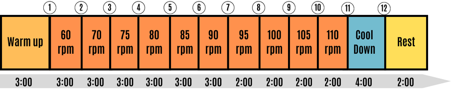

# 公开运动恢复记录

RePulse运行时只读取本地公开记录。原始BVP和运动量不会由程序生成；未下载记录、文件缺失或SHA256不符时，系统明确报错。

## 来源和本地位置

数据来自 Hongn 等人的 **Wearable Device Dataset from Induced Stress and Structured Exercise Sessions，v1.0.1**。

- [PhysioNet官方说明](https://physionet.org/content/wearable-device-dataset/1.0.1/)
- DOI：[10.13026/he0v-tf17](https://doi.org/10.13026/he0v-tf17)
- 原始研究：[Wearable Physiological Signals under Acute Stress and Exercise Conditions](https://www.nature.com/articles/s41597-025-04845-9)
- 许可证：Open Data Commons Attribution License v1.0；原始LICENSE随小样本下载并保留。

本次只保留有氧骑行S01、S02和S04三条记录的BVP、ACC、HR、tags四类CSV，原始文件合计约6.1 MB。记录位置为：

```text
data/public/wearable-device-dataset/1.0.1/
  AEROBIC/S01/{BVP,ACC,HR,tags}.csv
  AEROBIC/S02/{BVP,ACC,HR,tags}.csv
  AEROBIC/S04/{BVP,ACC,HR,tags}.csv
  metadata/{README,LICENSE,data_constraints,SHA256SUMS}.txt
  manifest.json
```

`data/`已被Git忽略，删除项目目录即可一并清理本地数据。首次部署在项目根目录执行：

```sh
conda activate repulse
python -m scripts.download_dataset
```

下载脚本优先使用数据提供方公开的PhysioNet S3镜像，失败后尝试PhysioNet原始链接。每个原始CSV均与官方SHA256SUMS核对；源代码包含本次固定版本的校验值，后续运行不会在线请求或自动替换数据。也可用`--subjects S02`只下载默认记录。

## 阶段起点的依据

这些Sxx记录属于作者的有氧第一版协议，原始tags.csv各有12个标记。已实际查看作者Notebook的协议图：



- 第11个标记（从0计数为10）：110 rpm负荷结束、开始低阻力踩踏恢复。
- 第12个标记：低阻力恢复结束、开始静止休息。

图像来源和Notebook SHA256记于 [dataset-protocol-provenance.json](dataset-protocol-provenance.json)。系统固定使用第11个真实事件，标注为**主动恢复**；没有按波形峰值、设备HR变化或网页点击时间猜测运动结束。

演示截取该事件前10秒至后124秒，共134秒、8576个原始BVP样本。演示时间轴从0开始，10秒处自动到达原始事件；三个8秒关键窗口相对于事件固定为[-4,4)、[56,64)、[116,124)秒。用户改变播放速度或拖动回放，不会改写原始事件及结果窗口。

原始日期已由数据提供方匿名平移；同次记录的相对时间仍对齐。界面中的记录创建日期属于本次运行，原始采集日期仅作来源与对齐信息。

## 保留原采样率和量纲

- BVP：64 Hz，原始有正有负的任意单位（a.u.）。不平移到虚构的ADC范围，也不进行100 Hz重采样。
- 加速度：32 Hz，原始整数单位为1/64 g。先除以64，再逐轴减去1秒时间常数的因果指数移动均值，取动态加速度三轴模。将最后一个已知32 Hz值保持到对应64 Hz时刻；不使用未来加速度。
- HR.csv：1 Hz，设备由同一条BVP计算的10秒平均脉率。它只作显示对照，算法不读取其值，不能称为独立ECG金标准。

处理记录的CSV同时保留原始匿名时间戳和XYZ加速度（g），加速度按最近已到达的32 Hz值对齐到64 Hz行。这些字段用于追溯原始记录，不参与替代脉率估计。

不同采集策略在原始观测进入DSP之前决定开启或关闭；关闭区间为明确缺测。重新开启后执行真实2秒预热。原始文件与各策略的输入标识一致，不能先用完整波形计算结果，再伪装漏采。

## 信号质量与当前样本结果

默认记录为S02，覆盖完整主动恢复阶段。它在60秒与120秒窗口具有可用估计，但起点窗口含形态和间期干扰，被当前工程质量规则拒绝。因此ΔPR60与ΔPR120会显示起点缺测，而不会借用之后的脉率填补起点。

S01和S04的部分关键窗口也有运动或波形干扰。这些记录用于展示系统如何保留真实波形、判断可用性和解释缺测。公开真人数据并不保证所有窗口都有可用数值；本次没有为了获得完整变化量而移动起点、替换波形或降低质量门限。

当前质量规则为工程规则：0.5–5 Hz因果Butterworth带通、8秒支持区间、2秒预热、峰间期中位数和自相关一致性检查。原始BVP中的负值是正常量纲，不会被当作ADC饱和。窗口完整性、重启与已发生的缺口均保留，缺测结果为null。

## 可复现检查

```sh
python -m pytest tests/unit/test_public_data.py tests/unit/test_signal.py tests/unit/test_policies.py
```

测试只使用已经下载并校验的真实记录，不在测试过程中请求网络。检查包括原始文件哈希、真实采样值逐点一致、64 Hz时序、固定事件、跨块滤波一致、缺口与预热传播，以及修改设备HR字段不改变算法结果。
