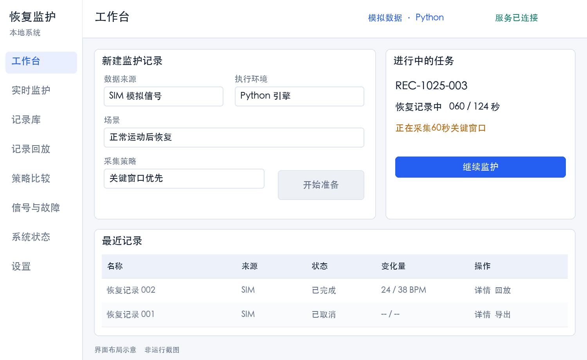
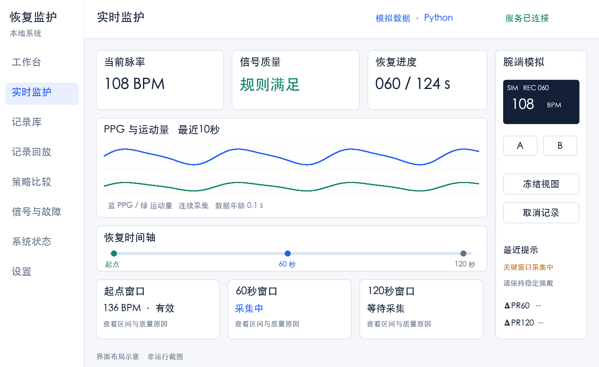
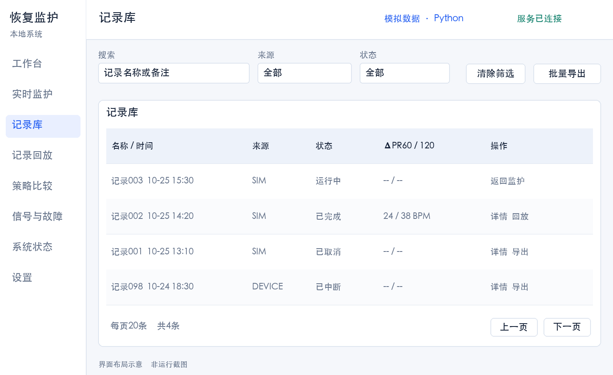
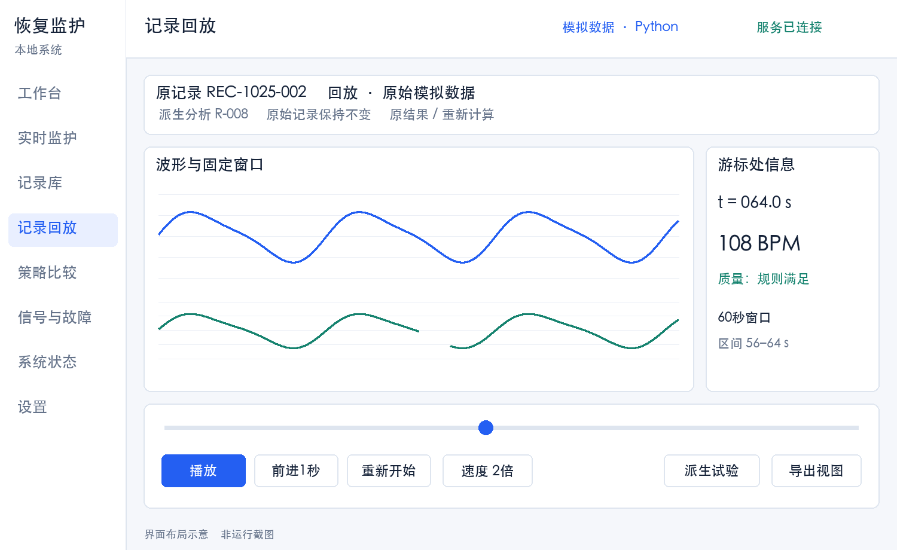
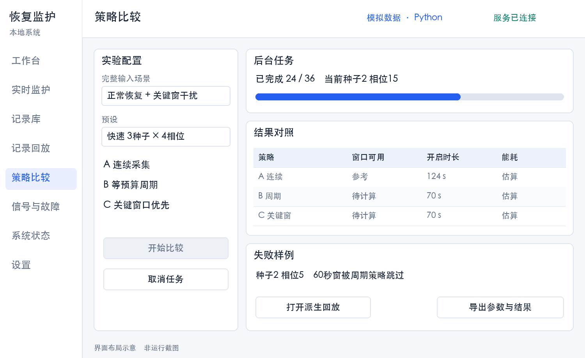
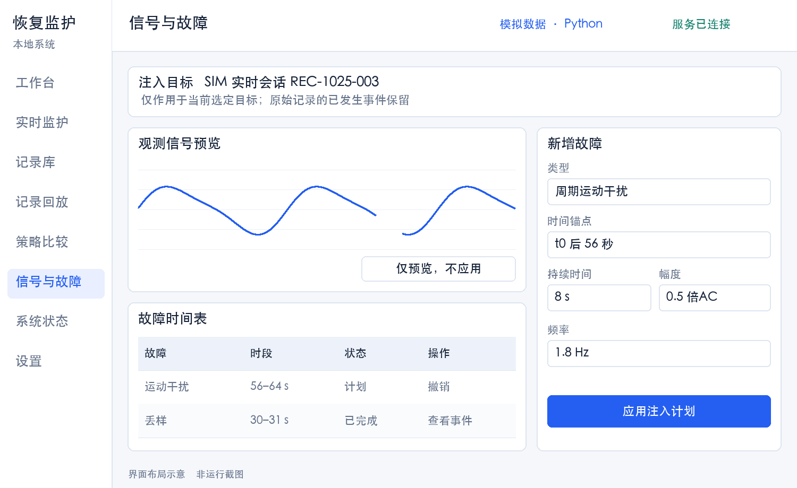
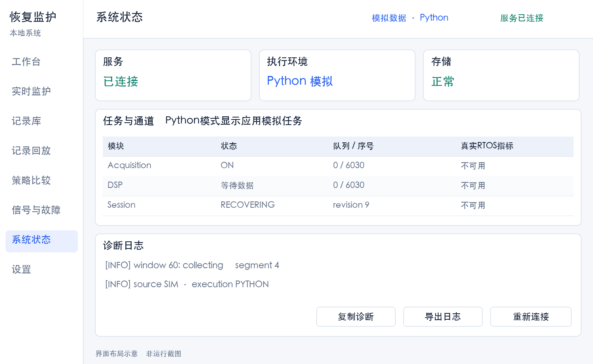
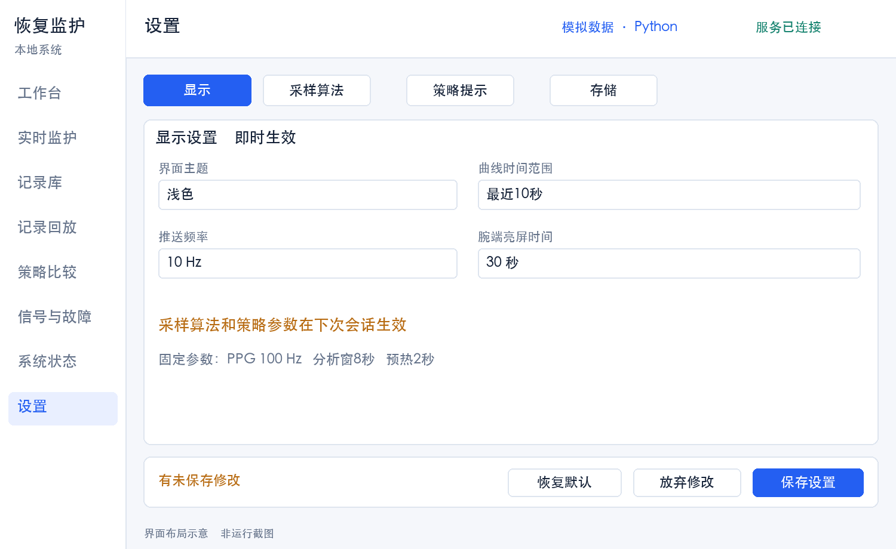

# 运动恢复监护系统设计规格

版本 2.0　项目 RePulse（复脉）　更新日期 2026年10月25日

实现与已执行验证见 [VERIFICATION.md](VERIFICATION.md)，未验证的设计要求不记为通过。

本系统是一套用于记录运动后心率恢复过程的可穿戴监护系统原型，由腕带端监护程序和电脑端可视化应用组成。使用者在运动前开始记录，运动结束时按键标记起点；系统随后观察约两分钟的脉率变化，显示波形、信号质量，以及起点、60秒和120秒附近的测量结果，计算恢复变化量并保存整次记录。电脑端提供实时监护、腕带屏幕模拟、历史记录、回放、故障模拟和采集策略比较。关键时段信号不可靠时，系统明确显示缺测及原因，方便查看这次恢复记录是否完整。开发先在电脑上用模拟信号完成操作和界面，再通过QEMU运行FreeRTOS程序，并预留STM32与真实传感器接口，因此前期无需购买硬件。

本文件规定后续工程必须实现的功能、页面、交互、状态、数据和接口。功能使用F编号，页面使用P编号，验收使用A编号；实现与测试沿用这些编号。后续以本Markdown文件为实现依据，Word为同内容阅读版。

## 1 实现范围与技术选型

### 交付范围

- 一个可在本机运行的完整应用，包含8个页面、腕端模拟屏、16项功能和自动测试。
- 一个真实运行FreeRTOS的QEMU目标，通过统一协议接入应用的监护与诊断视图。
- 一套STM32固件源代码与板级接口；无开发板时完成交叉编译，电气和实机性能验证另行执行。
- 一个VS Code工作区，提供启动、调试、测试、QEMU构建和数据导出任务。

应用采用单用户本地模式，服务默认绑定127.0.0.1。第一版无账号、云服务或社交功能。日常操作以桌面浏览器为主，窄屏可完成查看、开始、取消、回放和导出。

### 固定技术栈

| 部分 | 选型 | 实现约束 |
| --- | --- | --- |
| 开发入口 | VS Code | 所有开发命令配置到tasks.json及launch.json |
| 后端 | Python FastAPI Pydantic Uvicorn | 单进程单worker；只允许一个活动实时会话 |
| 算法 | NumPy SciPy | 流式因果处理；独立于HTTP和UI |
| 前端 | 原生HTML CSS JavaScript模块 | 不依赖Node构建；Canvas绘图；Hash路由 |
| 数据 | SQLite及本地会话文件 | SQLite管理索引；CSV和JSON保存完整记录 |
| 测试 | pytest及浏览器自动化 | 单元、接口、完整流程和截图验证 |
| RTOS运行 | FreeRTOS QEMU Arm GNU工具链 GDB Make | MPS2 Cortex M3独立目标；不冒充STM32外设模型 |
| MCU目标 | STM32L476RG Cortex M4F | 与QEMU分别使用启动文件、链接脚本和BSP |

Python、浏览器、QEMU及编译器是运行依赖，VS Code统一调用它们。第一阶段即可无硬件完成全部PC功能与界面；第二阶段接入QEMU的真实任务与队列。依赖版本在实现时锁定到项目环境。

## 2 功能清单

以下F01至F16均纳入工程交付。F13按PC、QEMU、STM32三个执行环境分阶段验证；无设备时，相关入口禁用并解释原因。

| 编号 | 功能 | 具体交付 | 页面 |
| --- | --- | --- | --- |
| F01 | 新建与配置会话 | 选择数据源、场景和策略；展示配置摘要；禁止重复活动会话 | P01 P02 |
| F02 | 准备与起点标记 | 6秒历史准备、t0锁定、历史不足提示、124秒收尾 | P02 |
| F03 | 实时监护 | PPG和运动曲线、当前脉率、数据年龄、冻结视图 | P02 |
| F04 | 关键窗口与变化量 | 起点、60秒、120秒卡片；区间、质量、缺测原因和依赖 | P02 P03 |
| F05 | 腕端交互模拟 | 128×64像素屏、A/B按键、页面切换和取消确认 | P02 |
| F06 | 质量与提示 | 预热、低质量、脱落、缺口、休眠、故障及过期提示 | P02 P06 |
| F07 | 场景和故障注入 | 参数化场景、定时故障、立即触发、停止或撤销、事件记录 | P06 |
| F08 | 记录管理 | 搜索筛选排序、详情、备注标签、单条及批量删除 | P03 |
| F09 | 独立回放 | 播放暂停、速度、定位、逐秒、重新开始；原记录保持不变 | P04 |
| F10 | 策略比较 | 三种策略、固定种子及相位、后台进度、取消和结果对照 | P05 |
| F11 | 导出 | 摘要JSON、结果CSV、原始数据及事件ZIP、界面PNG | P03 P04 P05 |
| F12 | 系统诊断 | 服务状态、日志、队列、丢块、时钟、版本和任务信息 | P07 |
| F13 | 执行环境接入 | Python仿真、FreeRTOS QEMU、STM32接口及能力识别 | P01 P07 |
| F14 | 设置与预设 | 显示设置即时生效；算法策略参数下次会话生效；默认值和校验 | P08 |
| F15 | 持久化与恢复 | 刷新恢复视图；服务崩溃后标记中断；原始记录可追溯 | P01 P03 |
| F16 | 跨页交互完整性 | 来源标识、重连、空错误状态、未保存提示和窄屏布局 | 全部 |

## 3 导航与通用交互

### 页面和路径

| 页面 | 路由 | 导航名称 | 主要任务 |
| --- | --- | --- | --- |
| P01 | /#/ | 工作台 | 创建记录或进入正在运行的会话 |
| P02 | /#/monitor | 实时监护 | 观察和控制唯一活动实时会话 |
| P03 | /#/sessions | 记录库 | 查找记录；详情使用右侧抽屉 |
| P04 | /#/replay/{id} | 记录回放 | 回放指定记录，查看派生分析 |
| P05 | /#/compare | 策略比较 | 创建与查看比较任务 |
| P06 | /#/lab | 信号与故障 | 编辑模拟场景和故障时间表 |
| P07 | /#/system | 系统状态 | 查看真实执行环境和诊断 |
| P08 | /#/settings | 设置 | 管理显示、算法、策略和存储选项 |

左侧导航顺序固定。顶栏显示页面名、活动会话状态、数据来源和连接状态。活动会话存在时，全局显示“返回实时监护”入口；切页、刷新、关掉页面均不自动取消后台采集。

### 三种身份分别显示

- 数据来源origin为SIM、DEVICE或PUBLIC_DATA，保存到记录，不能被回放覆盖。
- 运行方式execution_mode为PYTHON、FREERTOS_QEMU或STM32_DEVICE。
- 查看方式view_mode为LIVE或REPLAY。示例显示“模拟数据 · Python”“模拟数据 · FreeRTOS QEMU”“回放 · 原始设备数据”。

没有设备或QEMU连接时，显示未连接，不生成虚假的电量、电流、任务心跳和运行百分比。模拟电量如启用，必须标记“模拟”；电流模型显示“估算”。

### 公共状态和命令反馈

| 状态 | UI行为 | 恢复操作 |
| --- | --- | --- |
| 加载 | 保留页面结构并显示加载提示；禁用依赖数据的按钮 | 请求完成后恢复 |
| 空数据 | 说明当前没有记录或任务 | 提供新建或调整筛选入口 |
| 命令等待 | 按钮显示处理中并防重复点击 | 查询命令实际状态，不假定成功 |
| 请求失败 | 就地显示可读原因；保留输入 | 重试，不自动清空表单 |
| WebSocket断线 | 顶部断线条；当前数字显示连接失效 | 自动重连并重新获取快照 |
| 能力不可用 | 控件禁用并显示缺少的运行条件 | 连接对应环境后刷新能力 |
| 未保存修改 | 显示未保存标记 | 离页选择保存、放弃或继续编辑 |

所有修改命令带幂等键。按钮点击后只有服务端确认生效才改变会话控制状态。重连按1、2、5、10秒退避，之后每10秒尝试；浏览器恢复联网或点击重连可立即尝试。

## 4 页面规格

### P01 工作台



布局：顶部是“新建记录”和“继续监护”；中部左侧是数据源、场景、策略配置，右侧是进行中任务；底部是最近5条记录和环境状态。新建配置使用完整名称与一句用途说明，不只显示缩写。

| 控件 | 行为与规则 |
| --- | --- |
| 数据来源 | 默认SIM；DEVICE无连接时禁用；QEMU属于执行环境选项 |
| 场景 | 正常恢复、关键窗干扰、起点不足、脱落、丢样、传感器超时六个预设 |
| 策略 | 连续采集、等预算周期、关键窗口优先；默认关键窗口优先 |
| 开始准备 | 校验配置，创建并启动会话，成功后进入P02 |
| 继续监护 | 有活动会话时显示其阶段及经过时间，点击进入P02 |
| 最近记录 | 点击打开P03详情；列表保留来源、状态及两个变化量 |
| 环境入口 | 查看Python或QEMU连接信息，进入P07 |

已有活动会话时禁用再次开始，并显示“已有记录运行中”。首次进入无记录时展示简短操作提示。启动失败留在本页保留选项，给出重试；未成功启动的会话不得伪装成正在采集。

### P02 实时监护



桌面采用主内容与右侧腕端栏。主内容顶部为脉率、当前质量、阶段计时三张指标卡；中部为PPG与运动量；下方为恢复时间轴和三个关键窗。右侧显示腕端屏、A/B键、会话操作及最近提示。

| 区域 | 必须显示的内容 |
| --- | --- |
| 脉率卡 | 当前值及BPM、有效状态、最后数据年龄；无效显示-- |
| 质量卡 | 规则满足、不确定或不合格；主要原因与查看详情入口 |
| 阶段卡 | 准备进度或恢复经过秒数；收尾阶段显示正在整理末窗 |
| PPG图 | 最近10或30秒；原始或滤波切换；缺口和关闭区间断线 |
| 运动图 | 加速度运动量及有效性，和PPG共享时间游标 |
| 恢复时间轴 | t0、0/60/120秒目标、采集/预热/关闭段和当前游标 |
| 关键窗卡 | 等待、采集中、处理中、有效或缺测；统计区间和结果 |
| 变化量卡 | ΔPR60和ΔPR120；不可算时显示依赖窗口及原因 |
| 事件列表 | 最近10条；可展开更多，显示事件时间和类型 |

| 操作 | 可用条件 | 点击结果 |
| --- | --- | --- |
| 标记运动结束 | PREPARING | 首次点击立即锁定唯一t0；历史不足只提示，不二次确认后移时刻 |
| 冻结视图 | 正在连接实时会话 | 停止图表滚动，后台继续；显示冻结标记和返回实时 |
| 查看关键窗 | 窗口已开始或结束 | 抽屉显示固定区间、样本、原因和计算依赖 |
| 取消记录 | PREPARING或RECOVERING | 弹窗确认；确认前后台继续，确认后安全收尾 |
| 查看结果 | COMPLETED或CANCELLED | 打开P03对应记录详情 |
| 导出 | 完成、取消、中断或失败后文件稳定 | 按实际文件打开导出选项，不导出正在变化的半成品 |

从124秒进入FINALIZING，目标是2秒内整理完成；到期仍无法取得末窗则标明FINALIZE_TIMEOUT并保留部分结果。不得因为等待整理而把窗口延长到126秒。

### P03 记录库与详情



页面上方为搜索与筛选，主体为分页表格，右侧详情抽屉宽520像素。窄屏详情改为全屏。列表默认按创建时间倒序，每页20条；可按来源、日期、状态及标签筛选，搜索会话名称和备注。

| 列表列 | 规则 |
| --- | --- |
| 名称与时间 | 自动名称可编辑；展示本地时间，内部保存UTC |
| 来源与执行环境 | 两者分别标记，回放不改变原始来源 |
| 状态 | 完成、取消、中断、失败；当前活动会话显示运行中 |
| 窗口与变化量 | 显示三个窗口有效情况及ΔPR60/120；缺测为-- |
| 操作 | 详情、回放、导出、删除；按状态和文件可用性启用 |

详情分“概览”“波形与窗口”“事件”“配置”四个标签。概览显示阶段、t0、结果和缺测；窗口详情显示中心时间、名义区间、预热来源、结果可用时间、质量原因及关联原始数据范围。配置使用记录当时的快照。

备注和标签单独保存，不改原始结果。删除需确认，明确名称和条数；活动会话及被回放或比较任务占用的记录禁止删除。批量删除先校验全部ID，任一受保护则整体拒绝并列出原因，禁止只删除一部分却显示全部成功。

空记录显示新建入口；筛选无结果显示清除筛选。缺少原始文件时保留摘要详情，禁用完整回放，并说明缺失文件。删除后刷新列表和总数，若当前页为空退到上一页。

### P04 记录回放



上方为原记录信息和派生运行标识；主体为大波形区、脉率趋势及关键窗标记；右侧显示游标处数值与质量；下方为时间滑条及播放控制。进入页面不自动播放。

| 控件 | 行为 |
| --- | --- |
| 播放与暂停 | 仅推进或冻结回放时钟，不影响实时会话 |
| 速度 | 0.5 1 2 5 10倍；不修改采样率和窗口参数 |
| 逐秒前进 | 暂停时可用，推进1秒并处理相关数据 |
| 时间定位 | 拖动松开后定位；先显示重建中，再给出一致的滤波与结果 |
| 重新开始 | 游标回到原记录首样本，重置派生处理状态，包含t0前预历史 |
| 显示模式 | 原记录结果与重新计算结果可切换，标题明确区分 |
| 故障试验 | 创建新的analysis_run，跳转P06，绝不覆盖原数据 |
| 导出 | 导出当前视图PNG或派生结果；原记录导出仍来自P03 |

定位后从原记录首个准备样本重算，或使用经验证的状态检查点，禁止只移动游标而沿用错误滤波状态。重建必须包含t0前的预热和历史；界面可定位到t0，但不能跳过前置处理。每10秒保存一次派生状态检查点；检查点缺失时从首样本重建，显示进度。记录无原始波形时不进入伪回放。

播放结束显示已到末尾，保留结果；原记录t0不可编辑。原始缺口在回放中保持缺口。回放失败保留记录选择及错误原因，允许重新加载。离开回放页发送close命令释放原记录占用；浏览器异常离开则在30秒无心跳后释放。比较任务在完成、取消或失败后同样释放占用。

### P05 策略比较



左侧是实验配置；主体顶部为进度及启动/取消，下面是指标表、覆盖和开启时长图；底部列出可打开的失败样例。结果与配置区分开保存，改变表单后旧结果标为“与当前配置不同”。

| 项目 | 默认与约束 |
| --- | --- |
| 输入 | 不可变合成场景完整输入，或明确含完整输入的派生数据；不能用已漏采记录冒充完整输入 |
| 策略 | A连续100 Hz；B为20秒周期，按相位求解开启宽度以匹配C实际开启总长；C关键窗口优先 |
| 快速预设 | 3个种子，4个相位0 5 10 15秒，共36个策略运行 |
| 完整预设 | 30个种子，20个相位0至19秒，共1800个策略运行 |
| 参数校验 | 种子1至100组，起始种子默认20261025后递增；相位来自0至19秒；首版不并行多个比较任务 |
| 指标 | 三窗口各自可用率、两变化量可用率、错误有效率、同窗误差、开启时长及估算能耗 |

各策略共享同一准备历史和重启预热规则。B的相位取0至19秒，数值求解每个相位的开启宽度，使与124秒恢复区间相交的实际开启总长匹配C；初始理想值为70秒。开始后冻结输入和参数，返回job_id；每完成一个实验单元更新进度。切页不停止，重新进入显示同一任务。进度包括已完成、失败、总数和当前种子相位，不能用空结果加100%冒充成功。

取消后先显示CANCELLING，待当前安全单元结束显示CANCELLED。保留部分结果；成对汇总只纳入各策略都完成的种子相位组合，并报告排除数量。失败样例可打开P04的派生回放，查看哪些窗口未被采集或被质量规则拒绝。

### P06 信号与故障



左侧是场景预设和参数，中间为可预览波形与时间表，右侧为故障编辑器。页面必须显示当前目标：新会话草案、正在运行的SIM会话，或某记录的派生分析。不可隐式作用到另一个会话。

| 故障 | 参数 | 预期作用 |
| --- | --- | --- |
| 白噪声 | 标准差或相对幅度 | 改变观测信号，不直接设置算法质量答案 |
| 尖峰 | 幅度、频度、持续时间 | 注入局部异常 |
| 基线漂移 | 幅度及频率 | 低频变化 |
| 周期运动干扰 | 幅度、频率、是否伴随加速度变化 | 检查同频误判 |
| 脱落场景 | 持续时间及光强分布参数 | 改变光学输入；检测结果由算法判断 |
| 丢样与溢出 | 时间区间或丢块数 | 产生序号/区段缺口及事件 |
| 饱和与平线 | 截顶比例或固定值 | 检查无效处理 |
| 传感器超时 | 持续时间及恢复方式 | 驱动层错误、重试与新区段 |

开始锚点选择“准备开始后”“t0后”或“现在”；时间偏移非负，持续时间0.1至120秒，幅度按所选类型显示单位与范围。t0未确定时可登记相对t0的计划，但不能伪造已生效事件。

故障表显示计划、运行中、已停止、已完成或已撤销。未开始可撤销，运行中可停止；过去已写入原始记录的故障不能抹除。信号变换按基线漂移、周期干扰、噪声、尖峰、截顶顺序组合；传感器超时优先于信号输出，丢样作用于观测链末端。禁用冲突组合时给出原因。

点击预览仅生成预览；点击应用才提交。实时SIM故障命令保存实际生效时刻。DEVICE模式禁用注入，提供“另建模拟试验”；回放试验创建派生运行。算法接口只接收观测数据与可观测驱动状态，故障真值留给评估器。

### P07 系统状态



顶部为服务、数据源、执行环境和存储状态。主体分任务、数据通道、日志三个区域；高级诊断默认折叠，日常监护页不堆叠底层字段。

| 区域 | 字段与操作 |
| --- | --- |
| 环境 | Python版本、算法与协议版本、QEMU连接、MCU目标、能力列表 |
| 任务 | 任务名、状态、优先级、心跳、栈高水位；仅真实RTOS来源提供真实内核指标 |
| 通道 | 当前区段、样本序号、队列占用、丢块、采集事务错误、数据年龄 |
| 时钟 | 虚拟时间、单调时钟映射、t0及已知映射误差；不混用UTC |
| 存储 | 数据目录、可用空间、写入队列、错误及记录数量 |
| 日志 | 按级别和模块筛选、暂停滚动、复制诊断、导出日志 |

Python模式显示“应用模拟任务”，不得标为“FreeRTOS正在运行”。QEMU模式展示真实任务与队列计数，但耗时不能冒充STM32实测耗时。未接硬件时电池电压、电流与实机栈指标显示不可用。

重连只重连传输，不重置会话；清空日志仅清理前端显示缓存，不删除会话事件。切换执行环境只在无活动会话时允许。启动QEMU通过VS Code任务完成，页面提供连接状态与操作说明，不在网页内执行任意shell命令。

### P08 设置



采用显示、采样算法、策略提示、存储四个标签；页面底部固定保存与放弃操作。高级参数展开后显示单位、范围、默认值及生效时机。

| 设置 | 默认值与范围 | 生效时机 |
| --- | --- | --- |
| 主题与曲线窗口 | 浅色；10或30秒；首版固定浅色视觉 | 即时保存显示偏好 |
| UI推送频率 | 10 Hz，允许5或10 Hz | 即时，仅影响显示 |
| 数据过期 | 2秒，允许1至5秒 | 下次会话 |
| PPG采样 | 100 Hz IR 单通道 | 首版固定，只读 |
| 分析窗与预热 | 8秒与2秒 | 首版固定，只读 |
| 工程脉率范围 | 40至200 BPM | 首版固定，只读 |
| 默认策略 | 关键窗口优先 | 下次会话 |
| 越界演示 | 默认关闭；如开启50及120 BPM，恢复回差5 BPM | 下次会话；恢复阶段默认关闭 |
| 亮屏与腕端预览 | 亮屏30秒，允许10至120秒 | 即时作用于模拟屏 |
| 数据目录与保留 | 使用工程data目录；不自动删除记录 | 目录切换需无活动会话 |

保存后显示哪些即时生效、哪些下次生效。采样、算法和策略配置在会话开始后冻结；设置页不能偷偷更改正在运行的会话。恢复默认先改表单，点击保存才持久化。校验错误显示在字段下方，保存失败保留输入。

## 5 腕端模拟屏与视觉规范

### 六个腕端视图

| 视图 | 内容 | A键 | B键 |
| --- | --- | --- | --- |
| W01 待机 | 来源、电量状态、开始准备 | 开始准备 | 进入设置 |
| W02 准备 | 历史进度、质量、标记提示 | 立即标记t0；历史不足显示原因 | 切换质量详情 |
| W03 监护 | 恢复秒数、脉率、关键段/关闭状态 | 查看窗口进度 | 切换波形/质量页 |
| W04 窗口 | 三窗进度与缺测原因摘要 | 查看下一窗口 | 返回监护 |
| W05 结果 | 两项变化量或缺测 | 查看结果详情 | 返回待机 |
| W06 设置 | 亮屏、提示开关、退出 | 确认选项 | 下一项或返回 |

128×64原生像素绘制，预览按整数倍缩放，保持像素清晰。顶部8像素为来源和电量状态，底部保留至少2像素空白。腕端使用简短英文和数字，PC使用中文；所有缩写在PC详情中可解释。

记录中长按B 1秒打开取消确认，A确认，B返回；弹窗显示时采集继续。PC按钮与腕端按钮调用同一命令接口。W05只表示当前记录的结果，返回待机不删除数据。

### 视觉与响应布局

| 项目 | 固定规范 |
| --- | --- |
| 颜色 | 背景#F5F7FB 面板#FFFFFF 文字#152238 主色#245FF2 |
| 状态色 | 正常#16836F 警告#B76A10 错误#C43A44；配文字及图标 |
| 字体 | 系统中文无衬线；正文14至16像素；页标题24像素；主数值48像素 |
| 间距 | 8像素网格；桌面内边距24，窄屏16；面板圆角12 |
| 控件 | 桌面按钮至少40像素高，窄屏44；输入有标签、单位及错误位置 |
| 桌面 | 1200像素以上侧栏208；内容最大1520；监护支持主副栏 |
| 中屏 | 768至1199侧栏收为72；辅助面板折叠 |
| 窄屏 | 360至767单列；底部常用导航和更多菜单；详情全屏 |
| 图表 | 时间轴一致，缺口断开；支持悬停游标；禁止仅靠颜色表达有效性 |

所有主操作支持键盘焦点与Enter触发；弹窗限制焦点并可Esc返回。整页不得横向溢出，数据表允许在自身区域横向滚动。被冻结视图必须持续显示冻结标记；低质量、计划关闭和连接断开使用不同提示文字。

## 6 业务状态与控制规则

### 会话状态机

会话状态依次为CREATED、PREPARING、RECOVERING、FINALIZING、COMPLETED；活动状态可经安全收尾进入CANCELLED，无法恢复的处理或存储错误进入FAILED。服务重启后未结束记录进入INTERRUPTED，不自动续接原时间轴。

| 当前状态 | 事件 | 下一状态与副作用 |
| --- | --- | --- |
| CREATED | start_prepare | PREPARING；冻结配置、创建数据文件、启动采集 |
| PREPARING | 连续历史达到6秒 | 状态不变，history_ready为true；质量另行显示 |
| PREPARING | mark_end | RECOVERING；只写一次t0，生成窗口计划 |
| RECOVERING | 相对t0到124秒 | FINALIZING；停止新目标采集，排空尾部数据 |
| FINALIZING | 处理和落盘完成 | 按completion_target结束，生成摘要与清单 |
| PREPARING或RECOVERING | cancel | FINALIZING，completion_target为CANCELLED；保存部分结果和取消事件 |
| 活动状态 | 服务中断后重启 | INTERRUPTED，保留已落盘数据 |

正常到124秒时，completion_target为COMPLETED；FINALIZING拒绝新的取消。准备超时以CANCELLED结束，reason为PREPARE_TIMEOUT。收尾2秒上限按主机单调时间计算，存储失败进入FAILED；所有终态均可查看稳定的部分结果，并按文件可用性导出。采集状态另设OFF、STARTING、WARMING、ON、DRAINING、ERROR；质量状态另设UNKNOWN、VALID、POOR_SIGNAL、NO_CONTACT、DATA_GAP、SENSOR_FAULT、STALE。会话完成不代表三个窗口都有效。

### 不可违反的规则

- 一个后端进程仅一个实时SessionEngine；回放和比较使用独立对象，不改实时会话。
- t0由引擎权威时钟确定，只能写一次；同幂等键重试返回原结果，新的重复标记返回409。
- 历史不足仍可标记真实运动结束，起点缺测；不要求用户延迟按键伪造较晚t0。
- 冻结视图、回放暂停、策略关闭PPG是三件不同的事，禁止提供含义不清的暂停会话按钮。
- 浏览器断线不取消；传感器故障不重置t0；已有记录重算只能生成派生结果。
- FINALIZING具有2秒服务时间上限；存储失败不能宣布完成，末窗数据不足可完成并保留缺测。

## 7 采集与算法契约

### 固定参数和数据流

| 参数 | 第一版约束 |
| --- | --- |
| PPG | IR单通道100 Hz；MAX30102 Multi LED模式仅SLOT1为IR，平均1 |
| 原始块 | 最多16点；区段号、首序号、实际采样时间、配置号及缺口标志 |
| 滤波 | 0.5至5 Hz Butterworth；两个二阶节；状态跨块保持 |
| 重启 | 清理旧FIFO，创建新区段；实际首样本后至少2秒预热 |
| 常规估计 | 8秒连续窗口，1秒步长；至少3个可用峰间期 |
| 工程范围 | 40至200 BPM；100 Hz下间距30至150点 |
| 输出 | 峰间期中位数估计，辅以自相关一致性检查和原因码 |

质量先检查数据完整、饱和、有效波动、间期数量与一致性，再发布数值。接触阈值属于待标定配置，禁止把固定光强常数当作已验证规则。仿真场景真值只进入评估器，不经隐藏字段直接给算法答案。

### 关键窗口与启停计划

| 窗口 | 相对t0的名义区间 | 最早具备数据的时刻 | 依赖 |
| --- | --- | --- | --- |
| 起点 | [-4,4)秒 | t0后4秒及处理延迟 | 运动结束前已采集历史 |
| 60秒 | [56,64)秒 | t0后64秒及处理延迟 | 该区间及其预热历史 |
| 120秒 | [116,124)秒 | t0后124秒及处理延迟 | 该区间及其预热历史 |

ΔPR60为起点窗口估计减60秒窗口估计；ΔPR120同理。任一依赖窗口无效，对应变化量为null；仅60秒窗口失败不得使可用的ΔPR120消失。该结果标为窗口脉率变化量，不设置临床风险等级。

关键窗口优先策略在准备阶段连续采集，恢复段理想开启区间为[0,10)、[20,30)、[40,50)、[54,64)、[80,90)、[100,110)、[114,124)秒，总长70秒。重新开启先预热，目标区间不可被后移；命令需提前启动裕量，按实际首样本和实际开启并集计能。

64或124秒不能直接清空尾部FIFO。采集端完成区间内最后样本读取，DSP处理完毕后发布结果；区间外样本不能填入。IIR状态依赖窗口前历史，窗口记录保存预热起点与区段来源。

### 当前数值失效

计划关闭、脱落、数据缺口或故障立即使当前值无效。其他情况按当前引擎时间减最后支持数据结束时间判断，超过2秒显示--；不能按网页收到消息的时间刷新数据年龄。回放暂停按回放时间冻结，连接健康仍按真实经过时间检查。

## 8 后端结构与接口

### 模块责任

| 模块 | 责任 | 禁止事项 |
| --- | --- | --- |
| SessionEngine | 权威时间、状态转换、采集计划、命令串行执行 | HTTP直接修改内部状态 |
| SampleSource | 产生观测数据块；Python QEMU或设备适配 | 向算法泄漏场景真值 |
| SignalProcessor | 流式滤波、估计、质量及窗口结果 | 访问页面状态或修改原始记录 |
| SessionWriter | 单写入者、文件与索引一致性、错误报告 | 静默丢失原始数据 |
| SnapshotHub | 合并最新快照，向每个订阅端独立推送 | 用显示快照代替原始归档 |
| ReplayEngine | 独立时钟、定位重建和派生分析 | 修改原会话和实时t0 |
| CompareWorker | 独立进程执行实验单元与进度保存 | 阻塞实时服务事件循环 |

PYTHON模式的SessionEngine执行权威业务状态、策略和DSP；FREERTOS_QEMU模式由固件执行同一状态机、策略与DSP，Python通过EnginePort代理命令、接收确认与结果、持久化并推送UI。两种模式不能同时计算后择优发布。协议统一command_id、revision、timebase_id、样本区段和窗口结果。STM32沿用固件侧所有权；比较任务第一版仅在Python离线引擎运行。

### REST接口

所有接口以/api为前缀；写入命令携带Idempotency-Key，状态相关修改带expected_revision。幂等键、请求哈希和执行结果保存到SQLite，落盘后返回accepted；同键异请求返回409。先检查幂等命中，再检查版本。异步命令返回command_id和accepted，前端再等待applied或rejected。revision仅随业务控制状态或配置改变，普通波形更新不递增。start_prepare在引擎串行临界区和数据库事务中再次获取唯一活动槽，避免多个CREATED草案同时启动。服务重启后未执行命令标记为中断拒绝，已经执行的请求仍可返回原结果。

| 方法与路径 | 用途 | 关键规则 |
| --- | --- | --- |
| GET /bootstrap | 默认配置、能力、活动会话及版本 | 页面加载与重连入口 |
| POST /sessions | 创建会话 | 有活动会话返回409 |
| POST /sessions/{id}/commands | start_prepare mark_end cancel | 只接受合法状态和幂等键 |
| GET /commands/{id} | 命令执行状态 | 超时重试先查询，不重复创建命令 |
| GET /sessions/{id}/snapshot | 最新状态快照 | 与WebSocket数据结构一致 |
| GET /sessions | 分页筛选排序 | 默认page_size为20，最大100 |
| GET /sessions/{id} | 完整详情及参数快照 | 不返回无限原始波形 |
| PATCH /sessions/{id}/annotation | 名称、备注、标签 | 不修改原始结果 |
| POST /sessions/delete | 单条或批量删除 | 全部预校验，受保护则整体拒绝 |
| GET /sessions/{id}/samples | 时间区间及降采样查询 | 返回单位、来源和缺口信息 |
| GET /sessions/{id}/events | 游标分页事件 | 不依赖快照消息完整性 |
| POST /sessions/{id}/exports | 生成导出包 | 仅稳定终态；返回下载标识 |
| POST /replays | 创建派生回放 | 指定原会话，配置冻结 |
| POST /replays/{id}/commands | play pause seek step restart close | 与实时命令分离，close释放记录占用 |
| POST /comparisons | 新建策略比较任务 | 一个活动比较任务，输入不可变 |
| GET /comparisons/{id} | 进度和结果 | 明确部分失败与取消 |
| POST /comparisons/{id}/cancel | 取消比较 | CANCELLING后安全停止 |
| POST /faults | 创建目标明确的注入计划 | 仅SIM实时或派生分析 |
| POST /faults/{id}/commands | stop revoke | 不能删除已经发生的原始事件 |
| GET /system/status | 运行环境与诊断 | 不伪造RTOS或硬件字段 |
| GET PUT /settings | 读取和保存设置 | 带配置版本并返回生效时机 |
| GET /downloads/{id} | 下载已生成文件 | 仅服务端分配ID，不接受任意路径 |

错误统一包含code、message、field_errors和request_id。固定错误包括ACTIVE_SESSION_EXISTS、INVALID_STATE、REVISION_CONFLICT、SOURCE_UNAVAILABLE、RAW_DATA_MISSING、STORAGE_ERROR及INVALID_PARAMETER。不存在对象返回404，非法参数422，状态冲突409。

### WebSocket快照

WS /api/live订阅实时会话，WS /api/replays/{id}/live订阅回放。默认10 Hz推送，积压时合并旧快照；完整事件通过REST查询。每条快照至少包括以下字段。

```json
{
  "schema_version": 1,
  "stream_id": "server-run-id",
  "seq": 120,
  "session_id": "session-id",
  "revision": 9,
  "engine_time_us": 60000000,
  "timebase_id": "source-boot-id",
  "session_state": "RECOVERING",
  "acquisition_state": "ON",
  "origin": "SIM",
  "execution_mode": "PYTHON",
  "latest_result": {},
  "key_windows": [],
  "waveform_tail": [],
  "diagnostics": {}
}
```

前端按stream_id和seq丢弃旧消息；服务重启后stream_id变化，必须重新bootstrap。快照波形尾段有界，缺失显示帧不等于原始数据丢样。无新数据仍发连接心跳，不能用心跳替代数据更新时间。

## 9 数据与持久化

### 核心对象

| 对象 | 必需字段 |
| --- | --- |
| Session | id 名称 origin execution_mode status created_at_utc t0_us timebase_id completion_target config_snapshot versions |
| SampleBlock | segment_id first_seq count sample_times_us timebase_id values config_id gap_flag |
| WindowResult | id center_us start_us end_us available_us valid pulse_bpm reasons segment_ids |
| RecoveryResult | delta60 delta120 dependency_ids missing_reasons |
| Event | id session_id time_us type severity payload command_id |
| ReplayRun | id source_session_id config_snapshot cursor_us status checkpoints |
| CompareJob | id immutable_input_hash seed_list phase_list progress status result_paths |
| FaultPlan | id target_id type anchor start_offset_us duration_us params status |

内部时间使用整数微秒，UTC仅用于记录创建与列表日期。t0、样本、事件与窗口边界属于同一timebase_id；engine_time_us表示该时基当前时间。DEVICE与QEMU重启产生新时基，原活动记录标记中断；硬件样本另带时间映射误差，不能用I2C接收时间冒充精确采样时间。回放保存原始时间，游标从首个准备样本开始，相对t0显示通过减法得到。序列缺失和不同区段不能无标记地拼接。缺测使用null，导出JSON禁止NaN和Infinity。

### 本地目录

```text
data/
  app.sqlite
  sessions/{session_id}/
    meta.json
    ppg.csv
    accel.csv
    estimates.jsonl
    events.jsonl
    result.json
    manifest.json
  analysis/{analysis_run_id}/
    config.json
    derived_results.jsonl
    checkpoints/
  comparisons/{job_id}/
    config.json
    progress.json
    metrics.csv
    cases/
  exports/{export_id}/
```

SessionWriter顺序写原始数据与事件，每秒刷新文件，终态时刷新并关闭，再原子写入result和manifest，最后更新SQLite状态。manifest记录终态、文件列表、大小和哈希。名称、备注和标签的后续修改保存为SQLite中的独立注释，不改原始文件。启动时先检查有效终态manifest，已提交则补齐数据库；没有有效清单的活动记录标记INTERRUPTED，截去CSV或JSONL不完整尾行并保留其余部分，不伪装为连续恢复。

写入队列上限为10秒数据。达到高水位提示存储压力，达到上限触发明确存储失败并安全终止，不静默丢失原始数据。准备阶段默认最长30分钟，到期以CANCELLED及PREPARE_TIMEOUT原因结束，防止无限占用。回放占用使用可释放和超时的租约，历史分析行不永久锁住记录；删除先将目录移入同盘暂存区，索引事务提交后清理，事务失败则回滚移动。

### 导出契约

摘要JSON含状态、窗口、变化量、来源、配置及原因；结果CSV每行一个估计及时间支持；原始ZIP包含实际存在的原始文件、事件、配置和manifest。文件缺失明确报错，用户可选择“仅导出摘要”，不能返回空成功包。比较导出包含输入标识、种子相位、已完成与排除数量、指标和失败样例。PNG带来源、时间范围和模拟或估算标记。

## 10 FreeRTOS 与硬件适配

### 任务与通信

| 任务 | 优先级 | 触发 | 初始栈 |
| --- | --- | --- | --- |
| Acquisition | 6 | 100毫秒期限或FIFO保护通知 | 512 words |
| DSP | 5 | 原始块队列 | 1536 words |
| Session | 4 | 命令和20毫秒期限 | 768 words |
| Feedback | 3 | 结果快照及100毫秒期限 | 512 words |
| UI | 2 | 100毫秒期限 | 768 words |
| System | 1 | 1秒及诊断事件 | 512 words |
| Idle | 0 | 内核 | 256 words |

qRaw为单生产者到单消费者，8块，每块16点。UI、Session、Feedback各有独立长度1结果邮箱；使用覆盖更新最新值，不能共享一个被抢读的结果队列。事件另走有界可靠队列。任务和缓冲静态分配，栈和队列预算在实际构建后核对。

QEMU首选官方MPS2 AN385 Cortex M3目标，应用通过虚拟SampleSource接收PPG，不实现MAX30102完整寄存器模型。QEMU诊断协议报告真实内核任务、队列及版本；Python与QEMU执行相同测试样本并比较窗口结果和原因码。QEMU时间指标单独显示，不当作STM32实测。

### 预留硬件接口

| 模块 | 接口与要点 |
| --- | --- |
| STM32L476RG | 保留SWD；主控3.3 V；QEMU与MCU分别构建 |
| MAX30102 | I2C1 PB6 PB7；7位地址0x57；核心1.8 V LED3.3 V；INT开漏上拉3.3 V |
| FIFO | 32样本；正常100毫秒批读；17样本保护阈值；溢出创建新区段 |
| LIS2DW12 | I2C2 PB10 PB11；50 Hz初值；运动仅辅助 |
| 显示与按键 | SPI1 PA5 PA7；128×64；A/B命令与PC共用业务层 |

适配接口固定为Clock、SampleSource、CommandTransport、TelemetrySink和StorageSink。真实硬件只有在能力检查通过后才启用DEVICE入口。硬件数据缺失、电池未知和时间映射误差均需原样传到UI，不自动用模拟值替代。

## 11 工程结构与执行任务

```text
repulse/
  .vscode/tasks.json
  .vscode/launch.json
  pyproject.toml
  backend/api/
  backend/domain/
  backend/engines/
  backend/algorithms/
  backend/sources/
  backend/storage/
  backend/workers/
  web/js/pages/
  web/js/components/
  web/js/store/
  web/styles/
  firmware/common/
  firmware/qemu/
  firmware/stm32/
  scenarios/
  tests/unit/
  tests/api/
  tests/e2e/
  docs/SYSTEM_DESIGN.md
  data/
```

VS Code任务固定提供：Run App、Run Unit Tests、Run API Tests、Run UI Tests、Run Quick Compare、Build QEMU、Run QEMU和Build STM32。README给出环境安装与一次启动路径。前端页面卸载时注销订阅和监听器，避免切页后重复绘图或重复命令。

实现顺序：先建立状态、数据契约与反例测试；再做后端引擎及P01/P02完整流程；随后完成P03/P04持久化回放；再完成P05/P06；最后补齐P07/P08、窄屏、QEMU和STM32构建。完成的定义以本文件验收项为准，不以页面看起来能打开为准。

## 12 验收清单

| 编号 | 操作或输入 | 必须满足的结果 |
| --- | --- | --- |
| A01 | 从P01选择SIM并开始 | P02出现真实后台会话；重复点击不重复创建 |
| A02 | 连续准备6秒后标记 | t0写入一次，三窗计划固定 |
| A03 | 未准备够即标记 | 保留真实t0，起点显示历史不足；不延后起点 |
| A04 | 正常运行至124秒 | 经FINALIZING后终态；数据、事件和摘要已落盘 |
| A05 | 60秒窗口缺样 | 对应窗和ΔPR60缺测，可用ΔPR120保留 |
| A06 | 计划关闭或质量失效 | 当前值为--；关闭或缺样断线，低质量实存样本仍显示并标注 |
| A07 | 冻结视图后切页再返回 | 后台采集持续；可恢复最新视图，不改变t0 |
| A08 | 断开浏览器连接再重连 | 自动恢复状态；无重复命令或重复起点 |
| A09 | 取消并确认 | 保存部分记录并标CANCELLED；不显示正常完成 |
| A10 | 后端崩溃后重启 | 原记录INTERRUPTED；不伪装继续连续采样 |
| A11 | P03搜索筛选及批量删除 | 结果与计数一致；受保护记录整体拒绝删除 |
| A12 | 回放暂停及拖动定位 | 虚拟时钟冻结或重建；原记录哈希保持不变 |
| A13 | 比较启动取消再进入 | 任务状态可恢复，部分结果和排除数量明确 |
| A14 | 注入故障与撤销 | 正确目标和时刻生效；事件保留，不泄漏真值 |
| A15 | 导出摘要原始及PNG | 内容与选择一致；缺文件明确失败，不返回空成功 |
| A16 | 运行中修改设置 | 仅显示偏好即时变；采样算法参数留到下次 |
| A17 | Python与QEMU切换 | 只能无活动会话切换；运行方式与真实指标标识正确 |
| A18 | 360像素窄屏与键盘操作 | 无整页横向溢出；所有主要操作可达 |
| A19 | 三种策略使用相同输入 | 保存同一输入哈希；不先算完整结果再伪装漏采 |
| A20 | 所有8页空加载失败断线 | 有具体提示及可用恢复操作，无死按钮 |

每项验收保存对应日志、测试结果或截图。功能状态按未开始、实现中、待验证、通过记录；未运行的验收不得填通过。后续修改页面、字段或状态时，必须同步更新本文件和对应F/P/A编号。
