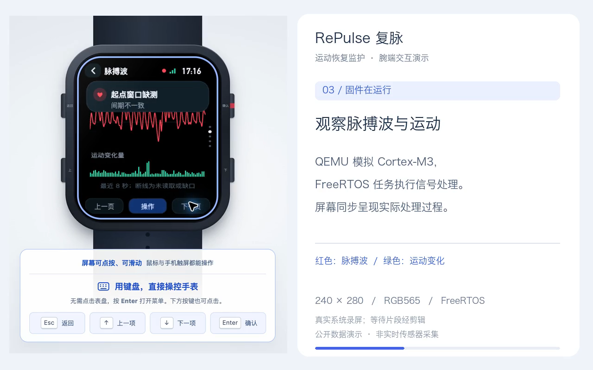

# 腕端主页演示

[播放或下载视频](repulse-demo.mp4) · [在线操作手表](https://legion-wsl.tailb5f334.ts.net:8443/)

2026-11-02 录制于当前腕端首页。视频为真实页面操作录屏，78 秒，1280×800，H.264，无音轨。画面裁切到手表和输入提示，并添加章节说明。

| 时间 | 操作 |
| --- | --- |
| 00:00 | 从表盘点按打开菜单 |
| 00:07 | 在屏幕内设置 S02 记录和关键窗口优先策略，滑动后开始 |
| 00:19 | 实时脉率、脉搏波和运动变化 |
| 00:29 | 系统状态与 FreeRTOS 任务 |
| 00:36 | 屏幕、输入与固件规格 |
| 00:41 | 关键窗口结果与读取计划 |
| 00:54 | 已归档记录和腕端回放；点按进度条、播放与变速 |
| 01:11 | 暂停、逐秒推进，长按键盘 Esc 返回表盘 |

处理路径为 QEMU 模拟 Cortex-M3 中的 FreeRTOS 固件，记录来自项目默认下载的公开穿戴设备数据集。本次按 1 倍速度处理 134 秒片段；视频剪掉操作间隔和等待时间，没有改变数据采样时间与窗口定义。S02 起点窗口因质量检查未通过而保留缺测，60 秒和 120 秒窗口分别为 142.2 和 130.2 次/分。

界面由浏览器 Canvas 绘制，支持鼠标、手机触屏、键盘和四个模拟实体按键。240×280 布局、RGB565 色深、输入语义和固件任务划分为后续移植提供边界；STM32 目标已可交叉编译，显示、触摸、按键及传感器驱动尚未上板验证。本视频不代表实体腕表或实时传感器采集效果。
